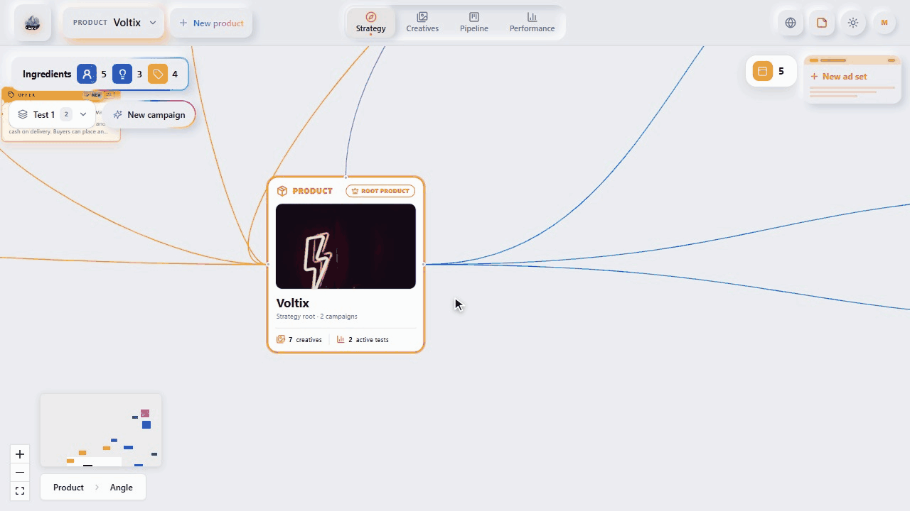
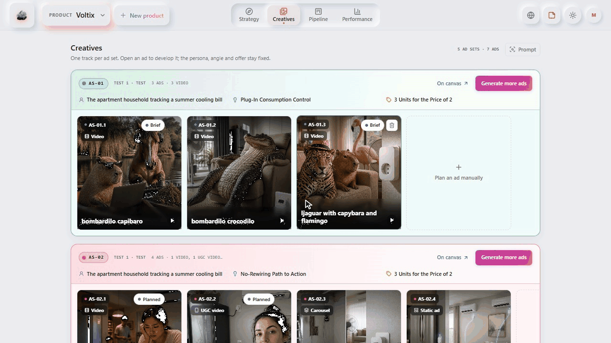
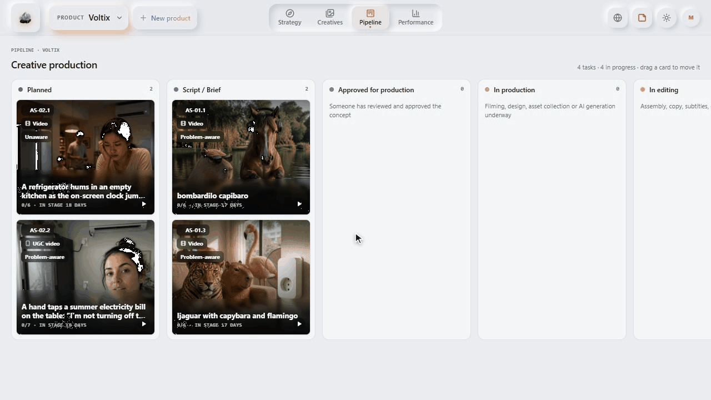
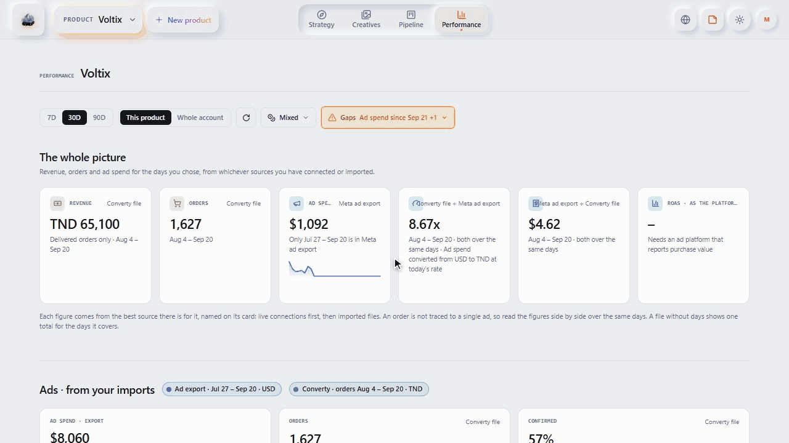

# PRISM

**Creative strategy for e-commerce Meta ads: from one product to a traceable plan of ads, and the results to learn from.**


PRISM is a workspace for planning Meta (Facebook and Instagram) ad creative. You add a product, AI proposes the
personas, angles and offers worth testing, and you combine them into concepts. Each concept becomes one ad set, each ad
set gets a plan of ads, and the ads move through a production board. Spend and orders from Meta Ads, Shopify and
CSV exports sit next to the plan, so every ad stays linked to the persona, angle and offer behind it.

```
Product → Persona × Angle × Offer (a concept) → Ad set → Ads
```



## What you can do

- **Strategy:** a canvas that grows from the product. Generate personas, angles and offers, then compose campaigns
  from them. The reasoning is in the [strategy framework](docs/creative-strategy/framework.md).
- **Creatives:** one track per ad set, with each ad planned along six dimensions (awareness stage, direction, format,
  hook, beats, call to action). The concept stays fixed inside an ad set.
- **Pipeline:** a board with eight stages and a per-format checklist for turning planned ads into finished creative.
- **Performance:** spend, orders, revenue and ROAS from Meta Ads, Shopify and imported Meta and Converty files, per
  product or for the whole account.
- **Context Library:** add customer interviews, objection CSVs, research PDFs or notes, and choose which ones feed
  each generation.







Each page is explained in the [user guide](docs/user-guide.md).

## Quick start

PRISM is a Next.js frontend and a GraphQL backend (graphql-yoga) that stores everything in a local SQLite file, so
there is no database server to install. It runs on your own machine.

You need:

- **Node.js 22.13 or newer.** The backend uses the built-in `node:sqlite`, so expect an
  `ExperimentalWarning: SQLite is an experimental feature` on start.
- **An API key for one AI provider** (OpenAI, Anthropic, DeepSeek, Gemini or Perplexity). Without one the app opens
  but generating anything fails.

```sh
git clone https://github.com/SeifPetit/PRISM.git
cd PRISM
npm install
cp .env.example .env        # Windows (cmd/PowerShell): copy .env.example .env
```

Open `.env`, set the provider and its key, and make `AI_PROVIDER` and `AI_MODEL` match:

```env
AI_PROVIDER=openai
AI_MODEL=gpt-5-mini
OPENAI_API_KEY=your-key-here
```

Run the backend and the frontend in two terminals:

```sh
npm run backend      # GraphQL API on http://localhost:4000/graphql
npm run dev          # app on http://localhost:3000
```

Open <http://localhost:3000> and sign in with a name and an email. A new email creates a personal workspace. The
database (`data/prism.db`) is created and migrated the first time the backend starts.

On Windows PowerShell, if `npm` is blocked by the execution policy, use `npm.cmd`.

### Connecting Meta, Shopify or Converty

Connections are optional and are saved per workspace with the token encrypted. Generate a key once, add it to `.env`,
and restart the backend:

```sh
node -e "console.log(require('node:crypto').randomBytes(32).toString('base64'))"
```

```env
INTEGRATION_ENCRYPTION_KEY=<the value printed above>
```

Each developer generates their own key and never commits it. Losing or changing it makes saved connections
unreadable, so reconnect them. Setup for each service is in [Integrations](docs/integrations.md).

## Data and privacy

- Sign-in is passwordless and **for local development only**. Email ownership is not verified, so do not expose a
  running instance to the internet.
- The database holds emails, sign-in session tokens, uploaded files (as base64) and encrypted integration tokens.
  `data/*.db` and `.env` are git-ignored. Keep it that way, and never share `prism.db` or `.env`.
- Context Library sources are stored as extracted text, not as the original file. Deleting a source or a product
  deletes its text.

## Documentation

- [User guide](docs/user-guide.md): campaigns, ad sets and ads, the production pipeline, Generation Setup and the Context Library.
- [Integrations](docs/integrations.md): Meta Ads, Shopify, Converty and CSV import, plus how the Performance tab works.
- [Development](docs/development.md): configuration reference, all `npm` commands and tests, project layout, troubleshooting.
- [Codebase map](docs/codebase-map.md) and [AGENTS.md](AGENTS.md): how the code fits together and the decisions behind it.
- [Landing page](public/landing/README.md): the static marketing page, served at `/landing/index.html` while the frontend runs.

## Known issues

Last checked on 2026-09-19:

- `npm run test:creative-exploration` has one failing Target Avatar test (it expects a 4096 token limit and gets 6000).
- `npm run test:frontend` exits with an error because no frontend test files match its configuration.
- Nodes saved by the removed Strategy Lineage mode and the removed Creative Concept and Direction steps are still in
  the database but hidden.
- TikTok Ads is not connected yet.

## License

No license has been chosen yet, so all rights are reserved by default.
